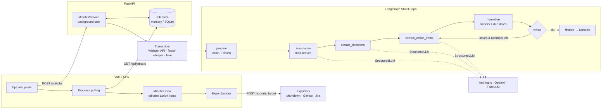

# meeting-minutes-agent

**Upload a meeting recording, get back structured minutes (summary, decisions, and action items with owners and real due dates), then push the action items to GitHub Issues or Jira.**

[](https://github.com/alexgeorghiou/meeting-minutes-agent/actions/workflows/ci.yml)
[](LICENSE)


The core is a LangGraph state machine. It cleans and chunks the transcript, summarises it, pulls out decisions and action items with Pydantic structured output, resolves owners and spoken deadlines ("by Friday", "end of month") deterministically, and runs a validation step that sends extraction back for another try when the result doesn't hold up. A FastAPI backend runs the pipeline as background jobs, and a Vue 3 UI lets you review and edit the action items before exporting them.

Everything runs offline by default. A deterministic `FakeLLM` and `FakeTranscriber` power the tests and the local demo. Real providers (Anthropic or OpenAI for the LLM, the OpenAI Whisper API or local faster-whisper for transcription) are selected with environment variables.

## Features

- **Pluggable transcription** behind a `Transcriber` protocol: OpenAI Whisper API (httpx, `verbose_json` segments), local [faster-whisper](https://github.com/SYSTRAN/faster-whisper) as an optional extra, and a fake that also accepts `.txt` transcripts.
- **LangGraph pipeline** with explicit nodes: `prepare → summarize → extract_decisions → extract_action_items → normalize → review`, plus a conditional **retry edge** from `review` back to extraction.
- **Structured output** with Pydantic (`Minutes`, `Decision`, `ActionItem`). Providers are wrapped by a `StructuredLLM` interface on top of LangChain's `with_structured_output`.
- **Deterministic normalisation**: owners are matched to attendees (exact, first-name, fuzzy for ASR misspellings, "I" → speaker). Due phrases are resolved against the meeting date: weekdays, "next Friday", "in two weeks", "within 3 business days", "EOM", "end of quarter", "Dec 3rd", "the 15th", ISO and `M/D` dates.
- **Map-reduce summarisation** for long meetings. Chunks overlap on line boundaries and duplicates from the overlap are merged.
- **Exporters** behind an `Exporter` protocol: Markdown, GitHub Issues (REST, one issue per open item) and Jira Cloud (REST v3 with an Atlassian Document Format description, `duedate` and optional assignee mapping).
- **FastAPI backend** with upload validation, background jobs with stage-level progress, in-memory or SQLite job store, action-item editing, Markdown download and export endpoints.
- **Vue 3 + TypeScript UI**: drag-and-drop upload or pasted transcript, progress polling, minutes view with editable owner, due date, priority and done state, and export buttons.
- A **CLI** (`minutes-agent process meeting.m4a`) for scripting.

## Architecture



### The review loop

`review` is deliberately **not** another LLM call. It is a set of deterministic checks over the normalised items:

| Check | Severity |
| --- | --- |
| Owner is not one of the attendees (likely hallucinated) | blocking → retry |
| Deadline phrase that can't be resolved to a date | blocking → retry |
| Due date before the meeting | blocking → retry |
| Description too vague (single word) | blocking → retry |
| No owner / due more than a year out / duplicate decision | warning → shown as "Needs review" |

On a retry, the blocking issues are put into the extraction prompt as feedback. When the attempt budget (`MINUTES_MAX_REVIEW_ATTEMPTS`) runs out, the remaining issues are kept on the minutes as review notes rather than failing the job.

## Quickstart

### Docker (API + web)

```bash
cp .env.example .env          # optional: add API keys / exporter credentials
docker compose up --build
# UI:  http://localhost:8080
# API: http://localhost:8000/docs
```

With the defaults (fake LLM and fake transcriber) you can upload any audio file, or a `.txt` transcript in `Name: text` format, and get real minutes from the rule-based fake.

### Local development

```bash
python -m venv .venv
source .venv/bin/activate            # Windows: .venv\Scripts\activate
pip install -e ".[dev,anthropic,openai]"
pytest
uvicorn minutes_agent.main:app --reload

cd web
npm install
npm run dev                          # http://localhost:5173, proxies /api to :8000
```

### Using real providers

```bash
export MINUTES_LLM_PROVIDER=anthropic          # or: openai
export MINUTES_ANTHROPIC_API_KEY=...           # or: MINUTES_OPENAI_API_KEY
export MINUTES_LLM_MODEL=claude-sonnet-4-5     # optional override
export MINUTES_TRANSCRIBER=openai              # Whisper API; or "local" with pip install ".[local]"
```

### CLI

```bash
minutes-agent process standup.m4a --attendees "Priya, Marco, Lena" --date 2026-11-18
minutes-agent process notes.txt --format json > minutes.json
```

### API at a glance

| Method | Path | Purpose |
| --- | --- | --- |
| `POST` | `/api/jobs` | Multipart upload (`file`, optional `title`, `meeting_date`, `attendees`) → `202` job |
| `POST` | `/api/jobs/transcript` | Submit a transcript as JSON |
| `GET` | `/api/jobs/{id}` | Status, stage and progress |
| `GET` | `/api/jobs/{id}/minutes` | Structured minutes |
| `PUT` | `/api/jobs/{id}/minutes` | Replace edited minutes |
| `PATCH` / `DELETE` | `/api/jobs/{id}/action-items/{item}` | Edit or remove one action item |
| `GET` | `/api/jobs/{id}/minutes.md` | Markdown download |
| `POST` | `/api/jobs/{id}/exports/{markdown\|github\|jira}` | Export |

## Configuration

All settings are environment variables prefixed with `MINUTES_` (see [`.env.example`](.env.example) and [`config.py`](src/minutes_agent/config.py)).

| Variable | Default | Notes |
| --- | --- | --- |
| `LLM_PROVIDER` | `fake` | `fake`, `anthropic`, `openai` |
| `LLM_MODEL` | provider default | any model name the provider accepts |
| `TRANSCRIBER` | `fake` | `fake`, `openai`, `local` |
| `JOB_STORE` | `memory` | `sqlite` persists to `SQLITE_PATH` |
| `CHUNK_WORDS` / `CHUNK_OVERLAP_WORDS` | `1200` / `100` | chunking for long transcripts |
| `MAX_REVIEW_ATTEMPTS` | `2` | total extraction attempts |
| `GITHUB_TOKEN`, `GITHUB_REPO` | – | enables the GitHub exporter |
| `JIRA_BASE_URL`, `JIRA_EMAIL`, `JIRA_API_TOKEN`, `JIRA_PROJECT_KEY` | – | enables the Jira exporter |

## Project structure

```
src/minutes_agent/
├── api.py                 # FastAPI routes + app factory (dependency injection via app.state)
├── service.py             # transcription → pipeline orchestration, progress updates
├── jobs.py                # Job model, in-memory and SQLite stores
├── models.py              # Minutes, Decision, ActionItem
├── config.py              # pydantic-settings
├── cli.py                 # `minutes-agent` command
├── transcription/         # Transcriber protocol, Whisper API, faster-whisper, fake
├── llm/                   # StructuredLLM protocol, schemas, FakeLLM, LangChain adapter
├── pipeline/
│   ├── graph.py           # LangGraph StateGraph and nodes
│   ├── text.py            # filler removal, speaker parsing, chunking
│   ├── dates.py           # spoken deadline → date
│   ├── owners.py          # owner → attendee resolution
│   ├── review.py          # validation that drives the retry edge
│   └── prompts.py
└── exporters/             # Exporter protocol, Markdown, GitHub Issues, Jira (ADF)
tests/                     # pytest: graph, extraction, dates, exporters (MockTransport), API (TestClient)
web/                       # Vue 3 + TypeScript + Vite SPA, served by nginx in Docker
```

## Design decisions and trade-offs

- **The LLM extracts, code computes.** The model is asked for deadline phrases verbatim, and `dates.py` resolves them against the meeting date. Models are unreliable at calendar arithmetic, and this approach can be unit-tested exhaustively. The cost is that unusual phrasings ("the Tuesday after the offsite") come back as `None` and are flagged for review.
- **Deterministic review instead of LLM-as-judge.** The checks that matter most (is the owner a real attendee? is the date real?) don't need a model. That keeps the retry loop cheap and predictable and makes it testable with scripted fakes.
- **Sequential nodes rather than a parallel fan-out.** Summary, decision and action-item extraction are independent and could run in parallel branches. They are kept sequential so the retry edge can re-enter extraction alone without re-joining the other branches, and so progress reporting stays linear.
- **A rule-based `FakeLLM` rather than canned responses.** It reads the same prompts a real model gets. That means API and graph tests exercise the actual prompt plumbing, and the app is usable with no keys. Tests that need specific outputs queue them per schema.
- **Background tasks plus a job store, not a queue.** FastAPI `BackgroundTasks` are enough for a single-node deployment, and the `JobStore` protocol keeps the door open for Redis or Postgres with a worker. Jobs are stored as JSON documents in SQLite so the schema can evolve with the Pydantic models.
- **httpx everywhere for outbound calls.** The Whisper, GitHub and Jira clients all accept an injected `httpx.Client`, so tests use `httpx.MockTransport` with no network and no extra mocking library.

## Roadmap

- Speaker diarisation (pyannote) so that transcripts without `Name:` labels still yield owners
- Streaming progress over Server-Sent Events instead of polling
- Idempotent re-export (remember created issue keys per action item)
- Linear and Slack exporters
- Calendar integration to prefill title, date and attendees

## License

[MIT](LICENSE) © 2026 Alex Georghiou
